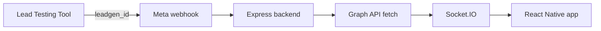

# Meta Lead Ads + React Native POC

## Overview

When someone submits a Meta Lead Ad form, Meta sends a webhook to the backend. The backend fetches the lead details and sends them to the open React Native app in real time. The lead appears on screen without manual action or polling.

## Architecture



## Project structure

```text
.
├── README.md
├── app/
│   ├── App.js              # Leads screen and Socket.IO client
│   ├── app.json            # Expo app configuration
│   ├── index.js            # Expo entry point
│   └── package.json        # React Native and Expo dependencies
└── backend/
    ├── .env.example        # Backend environment variable template
    ├── index.js            # Express routes, webhook, and Socket.IO server
    └── package.json        # Backend dependencies and start script
```

## Setup

You need Node.js, npm, an Expo-supported device or simulator, an ngrok account, and a Meta app with access to a Facebook Page and its test lead forms.

### 1. Configure and start the backend

In a terminal, go to `backend/`, install the dependencies, and copy `.env.example` to `.env`:

```sh
npm install
```

Set the values in `backend/.env`:

```dotenv
PORT=3000
VERIFY_TOKEN=choose-a-private-verification-string
PAGE_TOKEN=your-page-access-token
APP_SECRET=your-meta-app-secret
```

Use the same `VERIFY_TOKEN` when configuring Meta. `PAGE_TOKEN` must be a Page access token that can read lead details. Keep these values private and do not commit `.env`.

Start the backend:

```sh
npm start
```

The backend listens on port `3000` by default. Check it at `http://localhost:3000/health`.

### 2. Expose the backend with ngrok

In another terminal, run:

```sh
ngrok http 3000
```

Copy the HTTPS forwarding address ngrok provides, for example `https://example.ngrok-free.app`. The address may change when the tunnel restarts.

### 3. Configure the Meta webhook

In the Meta app dashboard:

1. Add/configure the **Webhooks** product and choose the **Page** object.
2. Set the callback URL to `https://<your-ngrok-host>/webhook`.
3. Enter the same value as `VERIFY_TOKEN`, then complete verification.
4. Subscribe the webhook to the `leadgen` field.

The backend verifies POST requests using `APP_SECRET`; make sure it is the App Secret for this Meta app. Subscribe the Page to the app as well, using its Page ID and Page access token:

```sh
curl -X POST "https://graph.facebook.com/v21.0/<PAGE_ID>/subscribed_apps?subscribed_fields=leadgen&access_token=<PAGE_TOKEN>"
```

A successful response should indicate that the Page was subscribed. The token used here should be the same Page access token set as `PAGE_TOKEN` in the backend.

### 4. Start the Expo app

In another terminal, go to `app/`, install dependencies, and start Expo:

```sh
npm install
npm start
```

In `app/App.js`, set `API_URL` to the HTTPS ngrok address without a trailing slash:

```js
const API_URL = 'https://<your-ngrok-host>';
```

The app uses this address for both its `/leads` request and its Socket.IO connection. Keep the app open to see new leads arrive.

## Environment variables

| Variable | Used by | Description |
| --- | --- | --- |
| `PORT` | Backend | Port for Express and Socket.IO; defaults to `3000`. |
| `VERIFY_TOKEN` | Backend and Meta | Private string used when Meta verifies the webhook callback. The values must match. |
| `PAGE_TOKEN` | Backend | Page access token used to fetch full lead details from the Graph API and subscribe the Page to the app. |
| `APP_SECRET` | Backend | Meta app secret used to validate webhook request signatures. |
| `API_URL` | Expo app | Base backend URL. This POC currently defines it as a constant in `app/App.js`, rather than reading it from an environment file. |

## Testing

### Test the live app connection

With the backend, ngrok tunnel, and Expo app running, open this URL in a browser:

```text
https://<your-ngrok-host>/debug/fake-lead
```

The backend creates a lead with a random name, email, and phone number, stores it, and emits it over Socket.IO. It should appear in the open app immediately.

### Test with Meta's Lead Testing Tool

1. Confirm the Meta webhook is verified, the `leadgen` field is subscribed, and the Page is subscribed to the app.
2. Open the Lead Testing Tool for your Page and select a lead form.
3. Create a test lead using the tool.
4. Watch the backend logs and the open Expo app. The backend should receive the webhook, fetch the lead through the Graph API, and emit it to the app.

## Troubleshooting

- **Meta cannot verify the callback:** Check that ngrok is running, the callback ends with `/webhook`, and Meta's verify token exactly matches `VERIFY_TOKEN`.
- **Webhook POST gets rejected:** Confirm `APP_SECRET` belongs to the configured Meta app and that Meta is sending its normal signature header.
- **A webhook arrives but lead details are missing:** Check that `PAGE_TOKEN` is a valid Page access token with permission to retrieve leads, and that the Page is subscribed to the app.
- **The app does not connect or refresh:** Make sure `API_URL` is the current HTTPS ngrok host, with no trailing slash, and restart Expo after changing it.
- **The fake lead works but Meta test leads do not:** Check the Meta app's webhook field subscription, Page subscription, app mode, and backend logs. A failed Graph API fetch is still emitted as an error lead by this POC.
- **Startup warns about missing values:** Set `VERIFY_TOKEN`, `PAGE_TOKEN`, and `APP_SECRET` in `backend/.env`, then restart the backend.

## Assumptions and limits

- The Meta app is in **Development** mode and testing is limited to permitted app roles and test leads.
- Leads are stored only in memory; restarting the backend clears the list.
- A public ngrok tunnel is used for Meta to reach the local backend.
- The app receives new leads with Socket.IO instead of polling.
- This is a proof of concept for test leads, not a production lead storage or delivery service.
